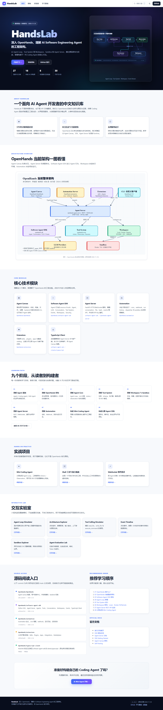
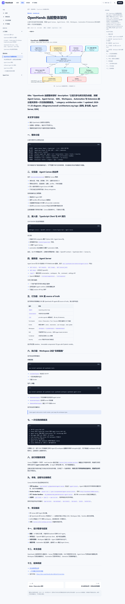
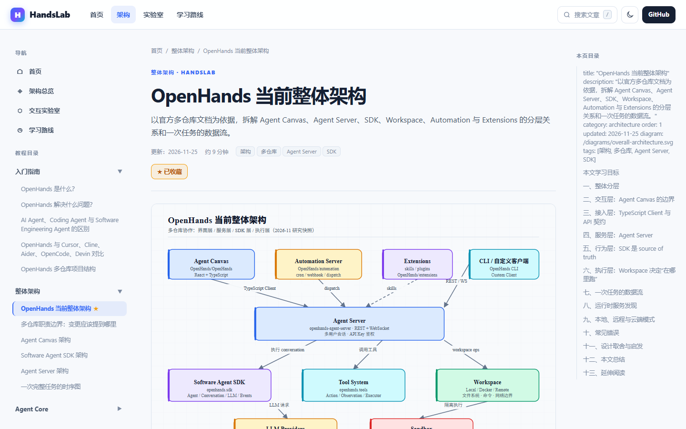
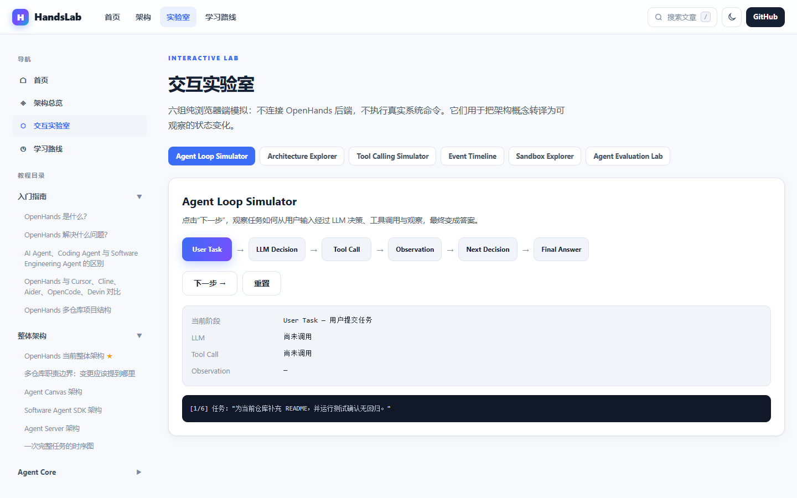
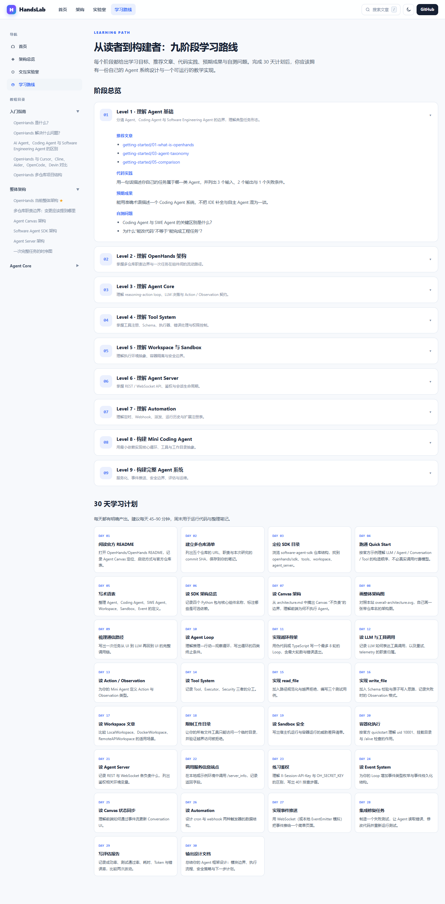

# HandsLab

**深入 OpenHands，理解 AI Software Engineering Agent 的工程架构。**

HandsLab 是一个面向 AI Agent 开发者的中文技术知识库。它以 OpenHands 官方仓库与文档为证据，拆解 Coding Agent 与 SWE Agent 的架构设计、执行机制、安全边界和工程化方法，帮助读者最终独立构建自己的 Agent 系统。

- 在线地址：<https://yuxinrun.github.io/handslab/>
- GitHub 仓库：<https://github.com/yuxinrun/handslab>
- 研究快照：2026-11-25
- 版本：v1.0.0

> 本项目是独立的学习与研究方向，不是 OpenHands 官方项目。

---

## 网站截图

以下截图均来自真实运行的构建产物（Playwright 浏览器截图），不是设计稿。

### 首页（桌面端）



### 首页（移动端）


### 文章页（桌面端）



### 架构图与文章布局



### 交互实验室



### 学习路线



---

## 功能介绍

- 独立设计的深色科技感首页，包含本地 SVG 主视觉与动态感执行流程。
- 27 篇有实质内容的中文深度文章，覆盖入门、架构、Agent Core、Tool System、Workspace、Events、Agent Server、Canvas、Automation、安全、实战与架构思想。
- 三栏文章布局：左侧章节导航、中间正文、右侧自动文章目录。
- 全站本地搜索（标题、描述、标签、正文摘要），支持 `/` 快捷键。
- 深色 / 浅色主题切换，偏好写入 `localStorage`。
- 代码高亮、一键复制、阅读进度条、面包屑、上一篇/下一篇、返回顶部。
- 文章收藏（仅浏览器 `localStorage`，无需账号）。
- 六组真实可用的浏览器端交互实验室：
  - Agent Loop Simulator
  - Architecture Explorer
  - Tool Calling Simulator
  - Event Timeline
  - Sandbox Explorer
  - Agent Evaluation Lab
- 九阶段学习路线与 30 天学习计划。
- 16 张本地绘制的 SVG 架构图，适配明暗两种阅读环境。
- 完整 SEO：title、description、Open Graph、sitemap.xml、robots.txt、favicon、404 页面。
- 纯静态部署，无后端依赖，完全兼容 GitHub Pages 子路径 `/handslab/`。

---

## 研究方法与版本说明

本项目坚持“先研究官方源码，再写文章”。研究时记录各仓库 main 分支 commit：

| 仓库 | Commit | 日期 |
| --- | --- | --- |
| `OpenHands/OpenHands` | `d56c1ab8e910500562cc157e13bdc8497283e032` | 2026-11-25 |
| `OpenHands/software-agent-sdk` | `a053dbc47bfd98e96c621fa1b1e8d154abb1154c` | 2026-11-24 |
| `OpenHands/automation` | `17fc93e057cbb102a53c4b356841578dbe9c9628` | 2026-11-25 |
| `OpenHands/extensions` | `d0902e63a40807d8259bef101a1d1600ce94bf88` | 2026-11-24 |
| `OpenHands/typescript-client` | 原仓库 README 仅保留迁移说明 | 待核实 |

主要参考文档：

- <https://docs.openhands.dev/>
- <https://docs.openhands.dev/sdk/arch/overview>
- <https://docs.openhands.dev/sdk/arch/agent-server>
- <https://github.com/OpenHands/OpenHands/blob/main/docs/architecture.md>
- 各官方仓库 README 与 examples 目录

内容规则：

1. 明确区分 Agent Canvas、Software Agent SDK、Agent Server、Automation、Extensions 与 TypeScript Client。
2. 不把历史 Runtime / V0 API 与新 SDK 架构混写。
3. 不把教学伪代码或简化实现冒充官方源码。
4. 无法从当前源码确认的内容标注“待核实”。
5. 对发生变化的 API 标注适用版本或 commit。

---

## 内容目录

```text
content/
├── getting-started/   入门：OpenHands 是什么、解决什么问题、术语辨析、产品对比、多仓库结构
├── architecture/      整体架构、职责边界、Canvas、SDK、Agent Server、任务时序
├── agent-core/        Agent Loop、LLM 工具调用、Action / Observation
├── tools/             Tool System 设计、自定义工具开发
├── workspace/         Workspace 抽象、Local/Docker/Remote、Sandbox 安全模型
├── conversation/      Conversation 设计与生命周期
├── events/            Event System、事件流与实时状态
├── server/            Agent Server REST API 实战
├── canvas/            Agent Canvas 产品与边界
├── automation/        Automation 调度、webhook、派发与运行历史
├── security/          Coding Agent 威胁模型与检查清单
├── practice/          Mini Coding Agent 完整实战
└── research/          架构思想总结与未来趋势
```

每篇文章都包含明确的学习目标、背景、核心概念、源码路径、示例代码、常见错误、设计取舍与延伸阅读。

---

## 技术栈

刻意保持轻量，避免大型框架和运行时依赖：

| 用途 | 方案 |
| --- | --- |
| 构建 | Vite 6 |
| 语言 | TypeScript 5（严格模式） |
| 页面 | 原生 HTML + 原生 JavaScript |
| 样式 | 原生 CSS（CSS 变量、Grid、Flexbox） |
| Markdown | `marked` |
| 代码高亮 | `highlight.js/lib/core`，仅注册所需语言 |
| 图表 | 本地 SVG（由 `scripts/generate-diagrams.mjs` 生成） |
| 路由 | Hash Router（刷新不 404） |
| 部署 | GitHub Actions + GitHub Pages |

运行时只有 `marked` 与 `highlight.js` 两个依赖；文章按需分片加载。

---

## 本地运行

前置条件：Node.js 22+、npm 10+。

```bash
git clone https://github.com/yuxinrun/handslab.git
cd handslab
npm install
npm run dev
```

打开终端输出的本地地址（通常为 `http://localhost:5173/handslab/`）。

`predev` 会自动生成文章清单与 SVG 图表。

---

## 构建

```bash
npm run build
```

该命令依次执行：

1. `scripts/generate-manifest.mjs`：扫描 `content/**/*.md`，生成 `src/data/articles.generated.ts` 与 `public/sitemap.xml`。
2. `scripts/generate-diagrams.mjs`：生成 16 张本地 SVG 到 `public/diagrams/`。
3. `tsc --noEmit`：严格 TypeScript 检查。
4. `vite build`：输出到 `dist/`。

本地预览构建产物：

```bash
npm run preview
```

静态校验：

```bash
node scripts/validate.mjs
```

---

## GitHub Pages 部署

项目已配置 `.github/workflows/deploy.yml`，使用 GitHub 官方 Pages Actions：

- `actions/configure-pages@v5`
- `actions/upload-pages-artifact@v3`
- `actions/deploy-pages@v4`

### 启用步骤

1. 在 GitHub 上创建仓库 `yuxinrun/handslab` 并推送代码。
2. 进入仓库 **Settings → Pages**。
3. 在 **Build and deployment** 中，Source 选择 **GitHub Actions**。
4. 确认仓库 **Settings → Actions → General → Workflow permissions** 允许读取仓库内容。
5. 推送到 `main` 分支（或在 Actions 页面手动运行 workflow）。
6. 等待部署完成后访问 <https://yuxinrun.github.io/handslab/>。

### 子路径适配说明

- `vite.config.ts` 配置 `base: '/handslab/'`。
- 所有图片与资源通过 `withBase()` 处理，兼容子路径。
- 路由使用 hash 模式（`#/article/...`），刷新页面不会 404。
- `404.html` 会回退到应用内 404 页面。
- favicon、robots.txt 与 sitemap.xml 均位于 `public/`，构建后自动复制到 `dist/`。

---

## 项目目录结构

```text
handslab/
├── public/
│   ├── diagrams/         16 张本地 SVG 架构图
│   ├── images/           首页主视觉 SVG
│   ├── favicon.svg
│   ├── robots.txt
│   └── sitemap.xml       （自动生成）
├── src/
│   ├── data/             站点元数据、学习路线、自动生成的文章清单
│   ├── pages/            首页、文章、实验室、学习路线
│   ├── styles/           全局样式与主题变量
│   ├── utils/            base path、Markdown、转义工具
│   └── main.ts           应用外壳、路由与全局交互
├── content/              27 篇中文 Markdown 文章
├── scripts/
│   ├── generate-manifest.mjs
│   ├── generate-diagrams.mjs
│   └── validate.mjs
├── screenshots/          6 张真实浏览器截图
├── .github/workflows/deploy.yml
├── index.html
├── package.json
├── tsconfig.json
├── vite.config.ts
├── 404.html
├── README.md
├── LICENSE
└── .gitignore
```

---

## 图片与 SVG 资源说明

- 所有最终使用的图片都是仓库本地文件，没有远程热链。
- `public/diagrams/*.svg` 由 `scripts/generate-diagrams.mjs` 绘制，包含统一配色、标题、标签与说明，可缩放且不依赖外部字体。
- `public/images/hero-agent.svg` 是首页主视觉，展示 Agent Loop 与事件流。
- `public/favicon.svg` 为站点图标。
- 本项目没有下载官方 Logo 或截图，因此不涉及第三方图片授权问题。若未来引入外部素材，必须记录来源 URL 与许可信息。
- 所有截图由 Playwright 对真实运行的构建产物生成，存放于 `screenshots/`。

---

## 贡献指南

欢迎提交 Issue 与 Pull Request。贡献时请遵守：

1. 文章必须基于官方仓库或官方文档，并写明源码路径与文档链接。
2. 教学代码必须明确标注为教学实现或伪代码。
3. 新增文章需包含 frontmatter：`title`、`description`、`category`、`order`、`updated`、`diagram`、`tags`。
4. 不确定内容标注“待核实”，不要猜测 API、目录或类名。
5. 新增或修改 SVG 时优先修改 `scripts/generate-diagrams.mjs`，再运行 `npm run diagrams`。
6. 提交前运行 `npm run build` 与 `node scripts/validate.mjs`。

---

## 质量检查记录

本次交付已实际执行：

- `npm install`：成功，无安全漏洞。
- `npm run build`：TypeScript 检查通过，Vite 构建成功，文章按页分片。
- `node scripts/validate.mjs`：文章 frontmatter、内部链接、SVG、截图、部署配置检查通过。
- 浏览器验证（Playwright）：首页、文章页、实验室、学习路线、移动端布局均正常，控制台 0 error / 0 warning。
- 交互验证：搜索（10 条结果）、主题切换与持久化、收藏持久化、代码复制、目录高亮、六个实验室交互全部通过。
- 响应式验证：390px 移动端首页与文章页横向溢出均为 0。
- 截图验证：6 张截图均由真实页面生成并检查文件存在且非空。

---

## License

[MIT](LICENSE) © 2026 yuxinrun

---

## 致谢与官方资源

感谢 OpenHands 团队开源其架构与实践，使系统性研究成为可能。

- OpenHands 官网：<https://openhands.dev/>
- 官方文档：<https://docs.openhands.dev/>
- Agent Canvas：<https://github.com/OpenHands/OpenHands>
- Software Agent SDK：<https://github.com/OpenHands/software-agent-sdk>
- Automation：<https://github.com/OpenHands/automation>
- Extensions：<https://github.com/OpenHands/extensions>
- SDK 论文：<https://arxiv.org/abs/2511.03690>
